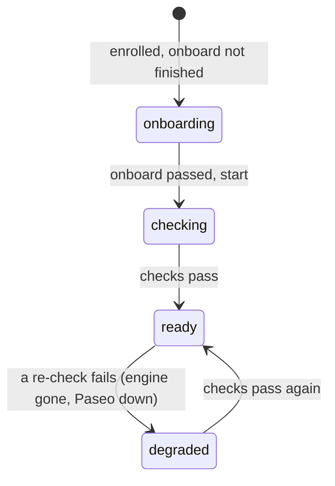

# mastermind-runner

The adapter a user runs on their own machine. It connects to Mastermind over
NATS (WebSocket) as a **service account** of the user's account, takes work from
queues and runs agents for it through Paseo. Agents never talk to Mastermind;
the runner reports for them.

Needs: `paseo` with its daemon running, and a provider that is logged in.

## Install (no clone, no bun)

Mastermind serves the runner compiled for linux and darwin (x64, arm64), built from
the same commit as the server. `/people` → **Add runner** shows the one command:

```bash
curl -fsSL <mastermind url>/install.sh | sh \
  && ~/.local/bin/mastermind-runner onboard <mme_token> --url <mastermind url> --queue <q> --workdir . --start
```

`install.sh` downloads `<url>/download/mastermind-runner?os=&arch=`, checks it against
`<url>/download/mastermind-runner.sha256?os=&arch=`, and installs nothing on a mismatch.
`MASTERMIND_RUNNER_DIR` changes the directory (default `~/.local/bin`). The runner reports
its commit (`mastermind-runner --version`); `/people` marks a runner on another commit
than the server as `old version`: run the install line again. The image build compiles
the targets in `RUNNER_TARGETS` (build arg, default `all`; ~45 MiB gzipped each).

## Onboarding: no work before the checks pass

A worker gets work only after its checks pass (mm-210.59). The client owns
onboarding: `onboard` runs these steps in order and stops at the first FAIL
with the line that fixes it. Run it again after the fix; an enrolled runner
skips the enrol step (the token is spent once).

| Step | Needs a credential | Checks |
|---|---|---|
| box engine | no | Docker or Podman answers (`DOCKER_HOST`); skipped with `--no-box` |
| Paseo and providers | no | `paseo ls` answers; each provider is available (logged in); the workdir exists |
| default box image | no | the image pulls (`--box-image`, `MASTERMIND_BOX_IMAGE`) |
| enroll | spends the token | the service account; settings are saved |
| queues | | at least one `--queue` |
| secrets | yes | the secret NAMES of its environments; a missing value is asked for (hidden prompt or stdin, never argv) |
| doctor --deep | yes | a real box and one real probe agent |
| ready | | writes `onboardedAt` in the config |

`enroll` alone is for scripts: the runner stays NOT READY until `onboard` passes.
`--start` starts the runner when it is READY.

The running runner has a readiness state and asks for work (`next`, offers)
only in `ready`:



- Runner-wide checks: Paseo daemon, providers, workdir, queues, box engine.
- Per environment: every secret the environment needs is present. A worker
  that is `ready` gets work only for the environments in `readyEnvironments`;
  items with no environment need `ready` only.
- Re-check: on start and every 5 min (Paseo every 15 s). Removing a needed
  secret drops that environment within 5 min.
- The status (`mm.u.<account>.r.<runner>.status`) carries
  `readiness: {state, readyEnvironments, failedChecks, checkedAt}`. Mastermind
  enforces it too: `next` and offers go only to a runner whose last status is
  `ready`, less than 2 min old, and lists the item's environment. Otherwise
  `next` answers `{dispatch: null, notReady: [reasons]}` (the runner logs it).
  `MM_READINESS_GATE=off` on the server turns the server side off.

## From source

```bash
# 1. In Mastermind, the account mints an enrol token (POST /api/auth/tokens {kind: "enrol", name}).
# 2. Onboard: checks, spend the token once, secrets, doctor --deep, READY. Settings given
#    here are saved with the credential (mode 0600).
bun src/cli.ts onboard <mme_token> --url <mastermind url> --queue <q> --workdir <dir> \
  [--provider claude] [--mode bypassPermissions] [--capacity 1|unlimited] [--capability git]...
# 3. Run.
bun src/cli.ts start          # flags here override the saved settings; --save keeps them
bun src/cli.ts check          # are the declared capabilities and the routing right?
bun src/cli.ts route --env web --queue q   # dry run: which target, and why
bun src/cli.ts status         # config without the secret
# --capacity unlimited (or 0): no limit on agents at once; runner.json stores "capacity": null.
```

Config: `$MASTERMIND_RUNNER_CONFIG`, else `$XDG_CONFIG_HOME/mastermind/runner.json`,
else `~/.config/mastermind/runner.json`. `MASTERMIND_URL` and `MASTERMIND_NATS_URL`
override the URLs. There is no default host.

## Doctor: test the real path

`mastermind-runner doctor [--deep] [--json] [settings]` tests what a dispatch really does.
Each step prints PASS, WARN, FAIL or SKIP, the time it took, and a `fix:` line. The exit code is 1 when a step fails.

| Step | What it tests |
|---|---|
| a. config | The config is readable. Mastermind accepts the credential (`GET /api/auth/credential`). The server version is the same as the runner version (WARN with the install command). |
| b. nats | The connection to NATS with the credential, with its time (WARN over 2 s). The runner may publish its status subject. |
| c. routing | For plain work on each queue: target, host, provider, mode, and the exact `paseo run` command line (no secret values). WARN when the mode asks for permission (claude: `default`, `plan`, `acceptEdits`): an unattended agent then waits forever. |
| d. paseo | The Paseo daemon answers. The decided provider is `available`. The workdir exists. The repo and environment checkouts are git checkouts. |
| e. agent | Only with `--deep`: a REAL `paseo run` with the arguments a dispatch uses and the prompt "Reply with the single word OK" (timeout 120 s). The agent has the labels `purpose=probe` and `mastermind.doctor=1`. The doctor archives it after the step. |

```bash
mastermind-runner doctor --deep          # all steps, starts one short agent
mastermind-runner doctor --deep --mode auto   # try a setting before you --save it with start
```

The running runner also answers the operator's remote doctor (`bun deploy/dokploy.ts debug doctor
<account>/<runner> [--deep]`, see docs/deploy.md). Steps a-d run on request. Step e starts an agent and
costs tokens, so remotely it runs only when you start the runner with `--allow-remote-probe`
(`--save` keeps it). The last report, local or remote, goes to Mastermind as `lastDoctor` in the
runner diagnostics.

## Secrets: what is needed, present, missing

Secret values stay on the runner machine. Mastermind knows only the NAMES: each
environment lists the secrets it needs (plus the provider login). The runner reads the
names from `GET /api/runner/environments` (with its credential) at start and every 5 min,
and keeps the last answer in `needs.json` for offline use. Needed = the secrets of every
environment this runner can get: all of them, or only the bound ones when `routing.json`
binds environments.

```bash
mastermind-runner secrets                  # NAME | NEEDED BY | PRESENT (never a value)
mastermind-runner secrets set GITHUB_TOKEN # type the value at a hidden prompt
printf %s "$TOKEN" | mastermind-runner secrets set GITHUB_TOKEN   # or pipe it
mastermind-runner secrets unset GITHUB_TOKEN
mastermind-runner secrets check            # exit 1 when a needed secret is missing
```

- The store is one file, `secrets` next to the config (`~/.config/mastermind/secrets`, or
  `MASTERMIND_RUNNER_SECRETS`), mode 0600, written atomically. The runner refuses a store
  that other users can read. A value is never taken from the command line.
- Where a value comes from: a source in `routing.json` (`environments.<name>.env`) wins,
  then the store, then the env var of the same name.
- A dispatch that needs a missing secret is declined at once:
  `missing secrets: A, B (on the runner: mastermind-runner secrets set A; ...)`.
- `doctor` step f fails for each missing secret, with the fix line. `status` and the
  operator debug view (`runners[].diagnostics.secrets`) show the needed and missing names.

## Box output: branch and pull request

The environment's `output` says how code leaves the box. After the agent says `done`:

| output | What the runner does in the box |
|---|---|
| `none` | Nothing. The patch stays on the runner (`results/<execution>.patch`). |
| `branch` | Commit what the agent left (message: the item title), then `git push --force origin HEAD:mm/<item>`. |
| `pr` | As `branch`, then on GitHub: open a pull request into `output.base` (default: the ref; a commit ref: the repo's default branch), or find the open one of an earlier try. Other git hosts: push only, and the ticket says so. |

- No change against the checked-out commit: `no changes: nothing pushed`.
- A retry starts again from the base and force-pushes the same branch: the pull request is updated.
- The git credential is one of the environment's secrets: `GIT_TOKEN`, `GITHUB_TOKEN` or
  `GH_TOKEN` (the first one given; also used for the GitHub API), or `GIT_SSH_KEY` (a deploy
  key). It is set on the checkout before the clone, so a private repo clones with it too. git
  reads the token file only when it asks: the value is never in a URL, argv or `.git/config`.
- The line (`pull request opened: <url> (...)`) is added to the completion summary: the ticket
  shows it. A failed push or pull request fails the task with the reason. Closing the item
  merges nothing.

## Box files: inputs in, outputs out

Files attached to a ticket go into the box. Files the agent makes come back to the ticket.
They move on NATS, in the bucket of the runner's account (`mm_files_<account>`). The auth
callout gives a runner that bucket and no other bucket.

| When | What |
|---|---|
| After the checkout, before the agent | Mastermind copies the item's inputs to the account bucket. The runner streams each one to `/workspace/.mastermind/in/<name>`. If this step fails, the task fails and the agent does not start. |
| The agent's prompt | It gets a line that names the inputs and `/workspace/.mastermind/out`. |
| After the agent | The runner uploads `changes.patch` (if there is a change), up to 20 plain files from `/workspace/.mastermind/out`, and `agent.log` (the last 256 KiB of the agent's output). The ticket shows `file out: <name> (<size>)`. If an upload fails, it is reported on the ticket and the task still completes. |

The runner adds `.mastermind/` to `.git/info/exclude`, so these files never go into the patch
or the pushed branch. Each file streams through the runner; no file is held in memory as a whole.

## Box network: open, none or an allow list

The environment's `network` sets what the box can reach:

| network | The box |
|---|---|
| `open` (default) | The engine's default network. |
| `none` | No network. |
| `{ "allow": ["github.com", "*.npmjs.org", "api.example.com:443"] }` | Only these hosts, through a proxy. |

For an allow list the runner makes three things, and deletes all three with the task:

- an internal network `<box>-net` with no route out,
- a proxy box `<box>-proxy` on that network and on the default network. It connects only to
  the allowed hosts (CONNECT for HTTPS, plain HTTP) and answers 403 for the rest,
- the task box on the internal network, with `HTTP_PROXY`, `HTTPS_PROXY` (and lower case),
  `NO_PROXY=localhost,127.0.0.1,::1` and `NODE_USE_ENV_PROXY=1`.

A tool that does not use the proxy (for example `ssh`, or git over ssh) has no network.
Entries: `host` (any port), `host:port`, `*.host` (subdomains only, not `host` itself).
List every host the task needs: the git host, the package registries, and the model API of
the agent (for Claude Code: `api.anthropic.com`).

The proxy runs with `node` or `bun` from the task's image. For an image without both, set
`MM_BOX_PROXY_IMAGE` (for example `node:24-alpine`). On Podman the internal network has no
DNS (the proxy is reached by address): this works without a user D-Bus.

## Box from devcontainer.json

Before any box is made, the runner does these steps on its own machine:

1. **Access check.** It runs `git ls-remote --exit-code <repo> <ref>` with the environment's git
   credential only (`GIT_TOKEN`, `GITHUB_TOKEN`, `GH_TOKEN` or `GIT_SSH_KEY`). It does not use this
   machine's git config, credential helpers, SSH agent or keys. When the check fails, the task
   fails with the reason, and no box is made. The reasons are: no access (the repo is private or
   does not exist, or the credential cannot read it), ref missing, or network.
2. **Find the config.** It fetches the ref without file contents (`--depth 1 --filter=blob:none`)
   and uses the first config that it finds:

   | Order | Config |
   |---|---|
   | 1 | The environment's own `devcontainer.config` (devcontainer.json text). Relative paths are relative to `.devcontainer/` of the repo. |
   | 2 | `devcontainer.configPath`: a path to a .json file, or a folder name under `.devcontainer/`. |
   | 3 | `.devcontainer/devcontainer.json` |
   | 4 | `.devcontainer.json` |
   | 5 | None: the old recipe (`image` + `tools`) or the default box image. |

   An environment with an `image` and no `devcontainer` settings keeps its recipe. To never
   use a devcontainer, set `devcontainer.use` to `none`.
3. **Clean.** These fields reach the host, so the runner removes them: `initializeCommand`,
   `runArgs`, `mounts`, `workspaceMount`, `privileged`, `capAdd`, `securityOpt`, `appPort`, and
   `build.options`. The ticket names each removed field. The runner refuses Docker Compose
   (`dockerComposeFile`). The box driver sets the limits and the network, as for every box.
   `initializeCommand` runs on this machine only when the environment lists it in
   `devcontainer.allowHost`.
4. **Build.** The official CLI (`@devcontainers/cli` 0.90.0) runs `devcontainer build` (image or
   `build.dockerfile`, and features). The runner starts the CLI with its own Bun
   (`BUN_BE_BUN=1 <runner> x --bun @devcontainers/cli@0.90.0`), so the machine needs no Node.
   To use another CLI, set `MM_DEVCONTAINER_CLI` (for example `devcontainer`). The CLI uses the
   docker CLI that `MM_BOX_DOCKER_PATH` names. The default is `podman` when the engine is
   Podman, else `docker`. That CLI must reach the same engine (and images) as the box driver.
   Then the runner adds the Mastermind layer: it copies node, Paseo and Claude Code from the
   default box image into `/opt/mastermind`. Only `paseo` and `claude` go first on `PATH`, so the
   image's own node stays the one that is used. The daemon runs as the dev container's user.
   The image is `mastermind-dc:<key>`. The key is a hash of the cleaned config, the git trees of
   the config folder and the build context, the CLI version and the default image. A second task
   with the same key does not build again.
5. **In the box**, after the checkout: the lifecycle commands from the image's
   `devcontainer.metadata` label, in the order of the spec. First every `onCreateCommand`
   (features first), then every `updateContentCommand`, `postCreateCommand` and
   `postStartCommand`. They run as `remoteUser` (else `containerUser`) in `/workspace`. Then the
   environment's `setup` and `check`, the files, and the agent. `containerEnv` is in the image.
   `remoteEnv` values that have no `${...}` become box env.

Secret names in the file:

- `customizations.mastermind.secrets: ["NAME"]` are required. When one is missing on the runner,
  the task fails before the build.
- The top-level `secrets: {"NAME": {...}}` (the GitHub Codespaces format) are recommended. The box
  gets the ones that are set. The ticket lists the ones that are not set.

`customizations.mastermind.instructions` is added to the prompt.

Not in v1:

- Feature `entrypoint`, `privileged`, `capAdd`, `securityOpt` and `mounts` (for example
  docker-in-docker). The ticket names each one as not applied.
- Images without glibc (Alpine). The copied node needs glibc.
- Docker Compose.

The git token stays out of the CLI and the build.

## Routing: which Paseo runs a dispatch

The user who runs the runner decides where work runs. Put `routing.json` next to the
config (or set `MASTERMIND_RUNNER_ROUTING`, or pass `--routing <file>`). It holds no secrets.

```jsonc
{
  // Named Paseo destinations.
  "targets": {
    "laptop": { "provider": "claude", "mode": "bypassPermissions" },
    "gpu": {
      "paseoHost": "gpu-box:6767",   // paseo --host; absent: the local daemon
      "provider": "codex",            // provider or provider/model; also "model", "mode"
      "labels": { "pool": "gpu" },    // extra labels on the agent
      "capacity": 1                   // agents at once on this target (runner capacity still applies)
    }
  },
  // Your binding of a Mastermind environment NAME (env:<name>) to this machine.
  "environments": {
    "web": {
      "dir": "/home/me/src/web",      // absolute path of the checkout
      "allowSetup": true,             // run the environment's setup commands (default false)
      "env": {                        // where each declared secret comes from
        "NPM_TOKEN": "file:/home/me/.secrets/npm",
        "GH_TOKEN": "env:MY_GH_TOKEN"  // unlisted secrets: the env var of the same name
      }
    },
    "ml": { "dir": "/home/me/src/ml" }
  },
  // Ordered; the first match wins. Every match field is optional; {} matches anything.
  "rules": [
    { "match": { "labels": ["secret-project"] }, "decline": "not on this machine" },
    { "match": { "env": "ml" }, "target": "gpu" },
    { "match": { "queue": "q", "maxPriority": 2 }, "target": "laptop", "mode": "auto" }
  ]
}
```

Match fields: `env` (environment name), `queue`, `stage` (`enrich_input`, `work`,
`enrich_output`), `type` (bead type), `labels` (all on the bead), `maxPriority` (this
priority or more urgent; 0 is the most urgent). A rule has `target` (plus optional
`provider`, `model`, `mode`) or `decline: <reason>`. Optional `defaults` per stage
(`{"work": {"provider": "claude"}}`) apply last.

Decision order:

| step | who decides | result |
|---|---|---|
| a. hard requirements | the instruction | `env.name` must be bound here (else declined); `env.requires`, secrets by name and `env.check` must pass. Met, or declined. |
| b. target | the user's rules | the first matching rule picks the target, or declines |
| c. agent fields | rule, then target, then the instruction (`env.agent.provider/mode`), then `defaults` | per field (provider, model, mode), the first that sets it wins; a provider from the instruction must be in `--providers` |
| d. no rule matches | the user | declined with the reason; Mastermind gets the bead back |

A declined dispatch is released with the reason. The first report of an accepted dispatch
names the decision, so the bead timeline shows where the work runs:
`target gpu on gpu-box:6767, provider codex (runner laptop, rule 2)`.

Per dispatch, after routing: the checkout is the binding's `dir` (a dispatch without a
bound environment uses `--workdir`, or `--repo <url>=<dir>` when it names a repo);
`env.requires` (`os:`, `arch:`, `<tool>`, `<tool>>=<version>`, opaque `ns:x`) must be
capabilities of the runner; the secrets must resolve (in a box they are box env and files
under `/run/mastermind/secrets`; with `--no-box` the agent gets a private dir (0700) whose
path is `$MASTERMIND_SECRETS_DIR`, with `$MASTERMIND_ENV_FILE` to source; values are never on
a command line; a `--no-box` task with secrets for a Paseo host on another machine is refused);
`env.setup` runs once per checkout and per setup (hash of the commands, kept in
`setup-state.json` next to the config) and only when the binding has `allowSetup`
(`--allow-setup` without a binding); `env.check` runs before every start. A failed step
releases the bead with the reason and the output tail. The lease is renewed from routing
on, so a long setup does not lose it.

```bash
mastermind-runner route --env ml --queue q          # dry run: the target and why
mastermind-runner route dispatch.json --label x     # a dispatch from a file, flags on top
mastermind-runner check                             # capabilities + routing: unknown targets,
                                                    # unbound environments, queues no rule takes
```

Without `routing.json` the old flags make one implicit target `default` (`--paseo-host`)
and two rules (work, and enrichment when `--assistant-provider` is set); `--provider`,
`--mode` and the assistant are the defaults, so the instruction's provider still wins over
`--provider`; a named environment uses `--workdir`/`--repo`. The runner tells Mastermind
the bound environments (`RunnerInfo.environments`), so it can skip a runner that cannot
take one.

## Direct offers: work sent to this runner

Besides the queues, Mastermind can send one item to one address: `<account>/<runner>`
(this runner) or `<account>` (each online runner of the account in turn). A routing rule
with `to`, or "send to" on the item, does that. The runner gets an OFFER on
`mm.u.<account>.r.<runner>.offer` and answers at once: accept, or decline with the reason.
It uses the same decision as for queue work: a free slot (a poll that only waits does not
count) and its routing (the item's `queue` is `to:<address>`, so a rule that matches only
queue `q` declines it). On accept Mastermind claims the item and sends the dispatch back;
then it runs like queue work. A decline, or no answer in 5 s, shows on the item with the
reason, and the next runner gets the offer.

## Running agents

`paseo run --output-schema` starts the agent (labels `mastermind.execution`,
`mastermind.bead`; never two agents for one execution), the runner heartbeats the lease,
and the agent's own answer decides: `done` completes the bead with its summary, `failed`
releases it with the reason. A lost lease stops the agent. Stop (Ctrl-C) stops agents
and releases their beads.

Exit codes: 0 stopped, 1 error, 2 usage, 3 revoked (Mastermind says the credential is
revoked; the config is marked `revoked`, enroll again).

NATS refuses the credential both after a revoke and for a moment after every NATS restart
(Mastermind's auth callout is not serving yet). So the runner keeps reconnecting through
auth errors and asks Mastermind `GET /api/auth/credential` (at most every 30 s). Only a
401 there means revoked; no answer, 5xx or 429 means "retry".

Tests: `bun test`. The NATS tests need `NATS_SERVER=/path/to/nats-server`
(`test/revoke.integration.test.ts`: NATS restart with the callout down 10 s, then a real revoke).
