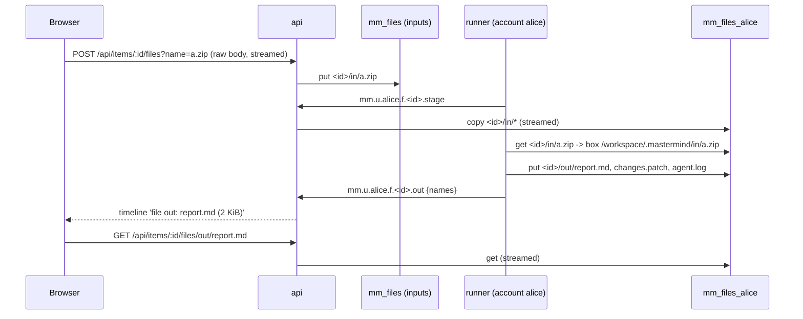

# Files of work items (mm-210.60)

Files attached to a ticket go into the agent's box. Files the agent makes come back to the ticket.
Files are kept in JetStream object stores on the same NATS as the work. There is no other storage.

## Buckets and names

| Bucket | Holds | Who can use it |
|---|---|---|
| `mm_files` | `<item>/in/<name>`: inputs uploaded on tickets | the api only |
| `mm_files_<account>` | `<item>/in/<name>`: copies of the inputs of the items this account runs; `<item>/out/<name>`: the outputs its runners made | the api, and the service accounts of `<account>` |

The auth callout gives a service account these publish subjects:
`$O.mm_files_<account>.>`, `$JS.API.STREAM.INFO|MSG.GET|PURGE.OBJ_mm_files_<account>`.
It cannot read or write another account's bucket or `mm_files`. Test: `apps/api/src/files/files-auth.integration.test.ts`.

The outputs of an item are in the bucket of the account that holds (or last held) its claim (`assignee` = `<account>/<agent>`).

## API

| Request | Result |
|---|---|
| `GET /api/items/:id/files` | `{inputs, outputs, maxBytes}` |
| `POST /api/items/:id/files?name=<name>` | Raw body. The api keeps `Content-Type`. Optional `X-Sha256` (hex): a different digest stores nothing. Answers 201 with the file, 413 when the file is over the limit. |
| `GET /api/items/:id/files/:dir/:name` | The file, as an attachment (`Content-Security-Policy: sandbox`, `X-Sha256`, `X-File-Size`). Bun sends it chunked. |
| `DELETE /api/items/:id/files/in/:name` | 204. Outputs cannot be deleted. They expire. |

Each transfer streams in 128 KiB chunks. The api never holds a whole file in memory. A test uploads 200 MiB and checks this.
File names are one path segment: at most 100 UTF-8 bytes, and other characters become `_`.

## Limits and configuration (api env)

| Env | Default | What |
|---|---|---|
| `MM_FILES_MAX_OBJECT_MIB` | 512 | Largest file. It also sets Bun's request body limit. |
| `MM_FILES_INPUTS_MIB` | 2048 | Size of `mm_files`. |
| `MM_FILES_ACCOUNT_MIB` | 1024 | Size of each `mm_files_<account>`. |
| `MM_FILES_OUTPUT_TTL_DAYS` | 30 | Age at which files in `mm_files_<account>` expire. Inputs in `mm_files` do not expire. |

JetStream reserves each bucket's size against the account limit: APP `max_file: 10G` in
`deploy/nats/nats.conf`. A test showed this: a third 4 GiB bucket was refused with
"insufficient storage resources available". At the defaults, APP holds MM_WORK (1 GiB) + `mm_files` (2 GiB)
+ 7 runner accounts (1 GiB each). **The APP limit was not raised.** Raise `max_file` in nats.conf
(and `max_file_store`) before an 8th runner account starts. Without that, the first stage or upload
for that account fails with the error above, and the ticket shows the error.
`GET /api/debug/state` → `files` lists the file count and bytes of each bucket.

## Backup

The object buckets are **included** in the scheduled backup (mm-210.36 snapshots every stream of
APP, `OBJ_*` too, streamed to `BACKUP_URL`). Their size limits bound the backup size:
about 2 GiB + 1 GiB per runner account, times `keep`.

## Runner side

See `apps/runner/README.md`, section "Box files: inputs in, outputs out".
